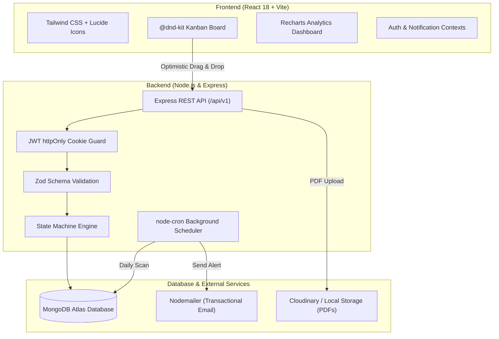
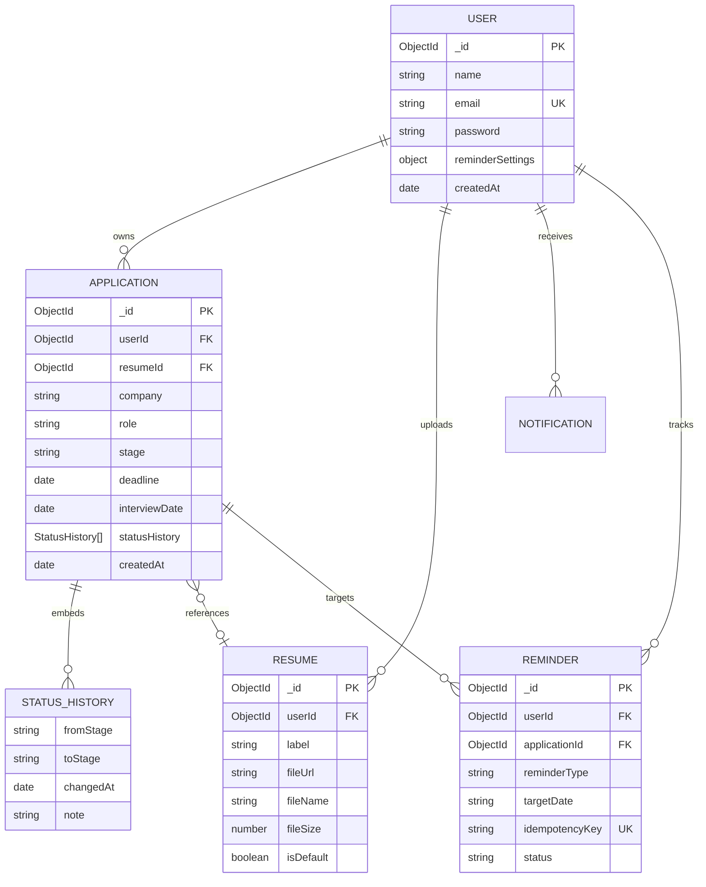

# ApplyTrack 🎯
### Intelligent Job & Internship Application Tracker with Smart Reminders & Pipeline Analytics

[](https://react.dev)
[](https://nodejs.org)
[](https://expressjs.com)
[](https://www.mongodb.com/atlas)
[](https://tailwindcss.com)
[](LICENSE)

ApplyTrack is a full-stack, university end-term capstone application built to solve the application management crisis faced by college students and fresh graduates. It replaces brittle spreadsheets with a drag-and-drop Kanban pipeline, a server-enforced finite state machine, automated background reminder sweeps, multi-version resume tracking, and native MongoDB aggregation analytics.

---

## 🔗 Live Demo & Links

| Resource | Link |
| :--- | :--- |
| 🌐 **Live Application (Frontend, Vercel)** | https://mern-end-term-project.vercel.app |
| ⚙️ **Backend API (Render)** | https://mern-end-term-project-pq9p.onrender.com |
| 🩺 **API Health Check** | https://mern-end-term-project-pq9p.onrender.com/api/v1/health |
| 💻 **GitHub Repository** | https://github.com/adiityaa09/mern-end-term-project |
| 🎬 **Demo Video** | https://drive.google.com/file/d/13iBbNlW3Zcv556MMTwBUWLkuUu7Z3psw/view?usp=sharing |

> ### ⚠️ Notes for Evaluators
> 1. **First load may take 30–60 seconds.** The backend runs on Render's free tier, which sleeps after 15 minutes of inactivity. Open the API link once to wake it up, then use the app normally.
> 2. **Use a normal (non-incognito) Chrome window.** Login uses a secure `httpOnly` cookie set by the backend on a different domain (`onrender.com`) than the frontend (`vercel.app`). Incognito mode, Safari and Brave block cross-site cookies by default, which can show an "Authentication required" message. In a normal window this works correctly.
> 3. **No demo account is needed.** Click **Sign Up** and create a new account. Passwords need 8+ characters, 1 uppercase letter and 1 symbol (for example `Demo@1234`).

---

## 1. Problem Statement & Target Audience

### The Problem
College students apply to 50–200+ internships and new-grad roles across multiple platforms (LinkedIn, Handshake, company career portals, referrals). Without dedicated tooling:
1. **Missed Deadlines**: Deadlines slip by unsubmitted because dates are scattered across browser bookmarks.
2. **Ghosting & Stalled Applications**: Students forget when they applied and lose track of when to follow up.
3. **Resume Confusion**: Candidates tailor multiple resumes (e.g., SDE vs. Frontend vs. Data) but cannot identify which version yields interview callbacks.
4. **Spreadsheet Inadequacy**: Spreadsheets cannot automate daily reminder notifications, validate lifecycle state transitions, or compute time-to-response funnel metrics.

### Target Audience
* College students seeking summer internships and co-ops.
* Final-year undergraduates running concurrent on-campus and off-campus recruitment pipelines.
* Career coaches and university placement cells monitoring candidate progress.

---

## 2. Solution

ApplyTrack gives each student a private control center for their entire job hunt. Every application lives on a Kanban board and moves through a validated lifecycle. Each move is recorded in an audit trail. Every application can be linked to the exact resume version that was sent. A daily background job reminds the student about deadlines, interviews and stalled applications. An analytics dashboard then shows what is actually working: response rate, offer rate, time to first response, weekly application velocity, and which resume version performs best.

---

## 3. Key Features & The 5 Core Workflows

### 🛡️ 1. Authentication & Tenant Ownership
* Secure registration and login with **bcrypt password hashing** (work factor 12).
* JWT authentication issued exclusively via **`httpOnly` cookies** with `SameSite` flags, protecting against client-side script token theft (XSS).
* Strict route guards ensuring all queries (`find`, `update`, `delete`, `aggregate`) are scoped to `req.user.id`.
* Brute-force mitigation using `express-rate-limit` on authentication endpoints.

### 📋 2. Drag-and-Drop Kanban Pipeline with Server-Enforced State Machine
* Interactive Kanban board built with `@dnd-kit` featuring **optimistic UI updates** and **automatic rollback** on server rejection.
* Seven lifecycle stages: `Wishlist` ➔ `Applied` ➔ `Online Assessment` ➔ `Interview` ➔ `Offer` ➔ `Rejected` (and `Withdrawn`).
* **Finite State Machine**: The server rejects nonsensical stage jumps (e.g., `Wishlist` directly to `Offer` returns `422 Unprocessable Entity` with the allowed next stages).
* **Audit Trail**: Every stage transition records an embedded `StatusHistory` entry containing the origin stage, target stage, timestamp, and optional notes.
* **Duplicate Prevention**: Compound database index (`userId + company + role`, case-insensitive) prevents duplicate applications.
* Search, filter by source/stage/deadline, and sort.

### 📄 3. Multi-Version Resume Management & Association
* Upload multiple customized PDF resumes with descriptive version tags (e.g., *"SDE Backend v2"*).
* Single-click toggle to designate a default resume for new applications.
* Validation: Multer enforces a 5MB size ceiling and PDF MIME-type verification.
* Dual-mode file storage: streams to **Cloudinary** when credentials exist, with automatic fallback to local disk storage.
* **Referential Protection**: Resumes linked to active applications cannot be deleted until unlinked or reassigned.

### ⏰ 4. Smart Background Reminders & Idempotency Engine
* Automated daily `node-cron` worker scanning active applications for 3 triggers:
  1. **48-Hour Deadline Alert**: application deadlines within 48 hours.
  2. **Interview Tomorrow**: interviews scheduled within the next 24–36 hours.
  3. **7-Day Stalled Application Follow-Up**: applications in *"Applied"* for 7+ days without updates.
* **Idempotency Guarantee**: Dispatches are guarded by a unique compound key:
  $$\text{idempotencyKey} = \text{userId} + \text{applicationId} + \text{reminderType} + \text{YYYY-MM-DD}$$
  If the cron task restarts or runs twice in a day, duplicate key error `11000` is caught and duplicate emails or alerts are skipped.
* Dual dispatch: transactional HTML email via **Nodemailer** and in-app bell notifications. Respects per-user email preferences. Failures are logged without crashing the job.

### 📊 5. Pipeline Analytics (MongoDB Aggregation Pipelines)
* **Stage Funnel**: visualizes drop-off and conversion bottlenecks using Recharts.
* **Recruiter Response Rate**: percentage of submitted applications that received a definitive response.
* **Offer Conversion Rate**: percentage of applications converted to offers.
* **Average Days to First Response**: duration from the `Applied` timestamp to the first response stage change.
* **Application Velocity**: weekly application submissions over time.
* **Resume Version Comparison**: compares interview callback rates across resume versions.
* **Graceful Zero-State**: empty states for new accounts, with no `NaN` values or crashes.

---

## 4. Tech Stack

| Layer | Technology | Why it was chosen |
| :--- | :--- | :--- |
| Frontend | React 18 + Vite | Fast dev server and builds, component model suits a board and dashboard UI |
| Routing / HTTP | React Router, Axios | Client-side routing; Axios interceptors and `withCredentials` for cookie auth |
| Styling | Tailwind CSS | Rapid, consistent responsive UI without custom CSS sprawl |
| Drag & Drop | `@dnd-kit` | Accessible, lightweight drag-and-drop for the Kanban board |
| Charts | Recharts | Declarative React charts for the funnel and trends |
| Backend | Node.js + Express | Simple REST API, large ecosystem, same language as the frontend |
| Database | MongoDB Atlas + Mongoose | Flexible documents suit embedded status history; aggregation pipelines power analytics |
| Auth | JWT in `httpOnly` cookie + bcrypt | Protects tokens from XSS; passwords are never stored in plain text |
| Validation | Zod | Schema validation of every request body |
| Security | helmet, CORS, express-rate-limit | Secure headers, origin restriction, brute-force protection |
| Files | Multer + Cloudinary (disk fallback) | PDF upload with type and size limits |
| Scheduling | node-cron | Daily reminder sweep inside the API process |
| Email | Nodemailer | Transactional reminder emails |
| Testing | Automated server tests (`npm test`) | State machine and reminder idempotency logic |
| Hosting | Vercel (client), Render (API), MongoDB Atlas (DB) | Free tiers with simple Git-based deployment |

---

## 5. System Architecture & Entity Relationships



**Deployment topology:** the React app is served by Vercel and calls the Express API on Render using `withCredentials`. The API talks to MongoDB Atlas, Cloudinary and the SMTP provider.

### Entity-Relationship Model



---

## 6. RESTful API Specification (`/api/v1`)

| Method | Endpoint | Auth | Purpose | Success Status |
| :--- | :--- | :--- | :--- | :--- |
| **POST** | `/api/v1/auth/register` | Public | Register new account (Zod validated) | 201 Created |
| **POST** | `/api/v1/auth/login` | Public | Authenticate user & issue httpOnly cookie | 200 OK |
| **POST** | `/api/v1/auth/logout` | Private | Clear authentication cookie | 200 OK |
| **GET** | `/api/v1/auth/me` | Private | Fetch authenticated user profile | 200 OK |
| **PATCH**| `/api/v1/auth/settings` | Private | Update reminder preferences | 200 OK |
| **GET** | `/api/v1/applications` | Private | List applications (search, filter, sort) | 200 OK |
| **POST** | `/api/v1/applications` | Private | Create application (duplicate check) | 201 Created |
| **GET** | `/api/v1/applications/:id`| Private| Get application details & timeline | 200 OK |
| **PATCH**| `/api/v1/applications/:id`| Private| Update metadata (company, role, notes) | 200 OK |
| **PATCH**| `/api/v1/applications/:id/stage`| Private | Move stage (finite state machine verified) | 200 OK |
| **DELETE**| `/api/v1/applications/:id`| Private| Delete application & associated reminders | 200 OK |
| **GET** | `/api/v1/resumes` | Private | List user resumes with application counts | 200 OK |
| **POST** | `/api/v1/resumes` | Private | Upload PDF resume (Multer + Cloudinary) | 201 Created |
| **PATCH**| `/api/v1/resumes/:id/default`| Private| Set default resume version | 200 OK |
| **DELETE**| `/api/v1/resumes/:id` | Private | Delete resume (blocked if attached) | 200 OK |
| **GET** | `/api/v1/notifications`| Private | Get notifications and unread badge count | 200 OK |
| **PATCH**| `/api/v1/notifications/:id/read`| Private | Mark individual notification as read | 200 OK |
| **PATCH**| `/api/v1/notifications/read-all`| Private| Mark all notifications as read | 200 OK |
| **GET** | `/api/v1/analytics/overview`| Private | Aggregation analytics (funnel, response time)| 200 OK |
| **GET** | `/api/v1/health` | Public | System uptime & MongoDB connection probe | 200 OK |

All errors use a consistent JSON format and proper status codes (400 validation, 401 unauthenticated, 403 forbidden, 404 not found, 409 duplicate, 422 invalid stage transition).

---

## 7. Local Setup & Installation

### Prerequisites
* **Node.js**: v18.0.0 or higher
* **npm**: v9.0.0 or higher
* **MongoDB**: local MongoDB instance or a free [MongoDB Atlas](https://www.mongodb.com/atlas) cluster

### Quickstart Guide

1. **Clone the repository**:
   ```bash
   git clone https://github.com/adiityaa09/mern-end-term-project.git
   cd mern-end-term-project
   ```

2. **Configure Environment Variables**:
   * **Server**:
     ```bash
     cp server/.env.example server/.env
     ```
     Edit `server/.env` and supply your database connection string and secrets:
     ```env
     PORT=5000
     NODE_ENV=development
     CLIENT_URL=http://localhost:5173
     MONGODB_URI=mongodb://127.0.0.1:27017/applytrack
     JWT_SECRET=replace_with_a_random_string_of_at_least_32_characters
     JWT_EXPIRES_IN=7d
     ```
   * **Client**:
     ```bash
     cp client/.env.example client/.env
     ```
     Set `VITE_API_URL=http://localhost:5000/api/v1`.

3. **Install Dependencies**:
   ```bash
   npm install --prefix server
   npm install --prefix client
   ```

4. **Run Automated Tests**:
   ```bash
   cd server
   npm test
   ```

5. **Start Development Servers**:
   * Server:
     ```bash
     cd server
     npm run dev
     ```
   * In a second terminal, client:
     ```bash
     cd client
     npm run dev
     ```
   * Open **http://localhost:5173**.

---

## 8. Environment Variables Reference

No secrets are committed to the repository. Copy the `.env.example` files and fill in your own values.

| Variable | Scope | Description | Default / Example |
| :--- | :--- | :--- | :--- |
| `PORT` | Server | HTTP port Express listens on | `5000` |
| `NODE_ENV` | Server | Runtime mode. **Must be `production` on Render** so cookies use `secure` and `sameSite=none` | `development` |
| `CLIENT_URL` | Server | Allowed CORS frontend origin. **No trailing slash.** | `http://localhost:5173` (prod: `https://mern-end-term-project.vercel.app`) |
| `MONGODB_URI` | Server | MongoDB Atlas or local connection URI | `mongodb+srv://...` |
| `JWT_SECRET` | Server | Secret key for signing JWTs | 32+ character random string |
| `JWT_EXPIRES_IN`| Server | Validity window of JWT cookies | `7d` |
| `CLOUDINARY_CLOUD_NAME` | Server | Cloudinary cloud name (optional; falls back to disk) | `your_cloud_name` |
| `CLOUDINARY_API_KEY` | Server | Cloudinary API key | `your_api_key` |
| `CLOUDINARY_API_SECRET` | Server | Cloudinary API secret | `your_api_secret` |
| `EMAIL_SERVICE` | Server | SMTP provider for Nodemailer | `gmail` |
| `EMAIL_USER` | Server | Email address used to send alerts | `you@gmail.com` |
| `EMAIL_PASS` | Server | Gmail 16-character App Password | `xxxx xxxx xxxx xxxx` |
| `VITE_API_URL` | Client | Base URL for Axios requests (set in Vercel for production) | `http://localhost:5000/api/v1` |

---

## 9. Deployment

| Part | Platform | URL |
| :--- | :--- | :--- |
| Frontend | Vercel | https://mern-end-term-project.vercel.app |
| Backend API | Render | https://mern-end-term-project-pq9p.onrender.com |
| Database | MongoDB Atlas | Managed cluster |

### Backend (Render)
1. Root Directory: `server`. Build Command: `npm install`. Start Command: `npm start`.
2. Add all server environment variables in the Render dashboard, including `NODE_ENV=production` and `CLIENT_URL=https://mern-end-term-project.vercel.app`.
3. **Atlas IP Allowlist**: in MongoDB Atlas, go to *Network Access* and allow `0.0.0.0/0` so Render can connect.

### Frontend (Vercel)
1. Root Directory: `client`. Framework Preset: **Vite**. Build Command: `npm run build`. Output Directory: `dist`.
2. Environment Variable: `VITE_API_URL=https://mern-end-term-project-pq9p.onrender.com/api/v1`. Redeploy after changing it, because Vite embeds it at build time.
3. `client/vercel.json` rewrites all routes to `index.html` so React Router works on refresh.

### Deployment Pitfalls & Solutions
* **Cross-Site Cookies over HTTPS**: when the frontend and backend are on different domains (`vercel.app` and `onrender.com`), browsers only keep the cookie when:
  1. `secure: true` (HTTPS only),
  2. `sameSite: 'none'`,
  3. `credentials: true` is set on both Axios and Express CORS,
  4. Express has `app.set("trust proxy", 1)` behind Render's proxy.

  This is handled in `auth.controller.js` and `app.js`. Browsers that block third-party cookies (incognito, Safari, Brave) may still reject it.
* **CORS errors**: `CLIENT_URL` must match the Vercel origin exactly, with no trailing slash.
* **Free-Tier Sleeping**: Render's free tier sleeps after 15 minutes of inactivity, which delays the first request and pauses in-process `node-cron` timers. A free pinger such as [cron-job.org](https://cron-job.org) or UptimeRobot can hit `/api/v1/health` every 10 minutes to keep the service awake.

---

## 10. Screenshots

> _Replace the placeholders below with your own screenshots (save them in a `docs/screenshots/` folder)._

| Screen | Image |
| :--- | :--- |
| Register / Login | `docs/screenshots/auth.png` |
| Kanban Pipeline | `docs/screenshots/kanban.png` |
| Resume Manager | `docs/screenshots/resumes.png` |
| Notifications | `docs/screenshots/notifications.png` |
| Analytics Dashboard | `docs/screenshots/analytics.png` |

Example Markdown: ``

---

## 11. Viva-Voce Questions & Design Defense

#### Q1: Why store the JWT in an `httpOnly` cookie instead of `localStorage`?
**Answer**: Tokens in `localStorage` can be read by any JavaScript running on the page. If the app has an XSS vulnerability, an attacker can steal the token. A cookie with `httpOnly: true` cannot be read by JavaScript. Combined with `secure: true` and a suitable `SameSite` value, it reduces token theft.

#### Q2: How does the Smart Reminder engine achieve idempotency?
**Answer**: A unique compound index on the `Reminder` collection:
$$\text{idempotencyKey} = \text{userId} + \text{applicationId} + \text{reminderType} + \text{targetDate}$$
Before sending an email or creating a notification, the processor inserts a reminder document with this key. If the cron job fires twice or restarts mid-batch, MongoDB throws duplicate key error `11000`, and the engine skips the duplicate.

#### Q3: Why validate stage transitions with a state machine on the server rather than just in the UI?
**Answer**: UI validation gives fast feedback but cannot be trusted. A user or script could send a `PATCH` request directly to `/api/v1/applications/:id/stage` jumping from `Wishlist` straight to `Offer`. The server-side state machine guarantees every application follows the allowed lifecycle and keeps an accurate audit trail in `statusHistory`.

#### Q4: Why `sameSite: "none"` in production but `lax` in development?
**Answer**: Locally, frontend and backend are both on `localhost`, so they are same-site and `lax` works. In production they are on different domains, so the browser only sends the cookie on cross-site requests if it is `SameSite=None` and `Secure`.

---

## 12. Known Limitations & Future Roadmap

**Known limitations**
* Cookie-based login across two domains does not work in browsers that block third-party cookies (incognito, Safari, Brave). A fix is to also accept the token via an `Authorization: Bearer` header.
* On free hosting, the cron job only runs while the Render service is awake.
* Local-disk resume storage (used when Cloudinary is not configured) is not persistent on Render's free tier.

**Future roadmap**
* **OAuth Integration**: Google / GitHub single sign-on.
* **Calendar Sync**: two-way sync of interview dates with Google Calendar / Outlook.
* **AI Resume Matching**: semantic similarity between resume text and job descriptions using embeddings.
* **Bearer-token fallback** for browsers that block third-party cookies.

---

## 13. Credits & Third-Party Libraries
* **Frameworks**: React 18, Vite, Express.js.
* **Database & ODM**: MongoDB Atlas, Mongoose.
* **Drag and Drop**: `@dnd-kit/core`, `@dnd-kit/utilities`.
* **Visualizations**: `recharts`.
* **Icons**: `lucide-react`.
* **Validation & Security**: `zod`, `bcryptjs`, `jsonwebtoken`, `helmet`, `express-rate-limit`.
* **File & Email Utilities**: `multer`, `cloudinary`, `node-cron`, `nodemailer`.
* **AI assistance**: parts of this project were developed with the help of AI tools for code generation, debugging and documentation. All code was reviewed, tested and understood by the author.

---

## 14. Author

**Aditya** · End-Term Software Project · GitHub: [@adiityaa09](https://github.com/adiityaa09)