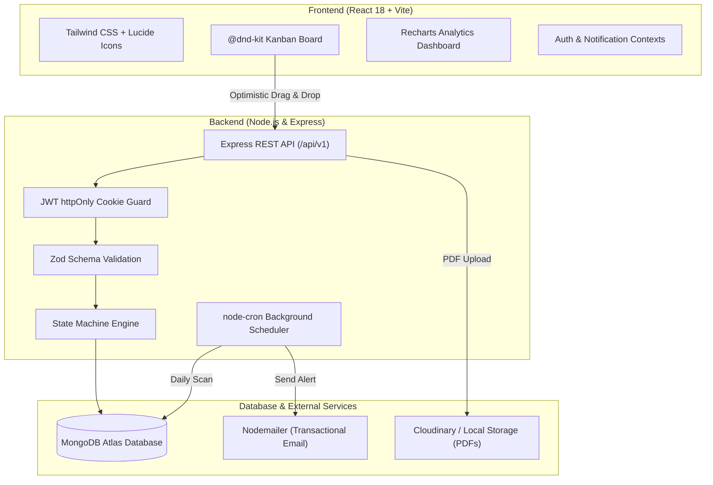
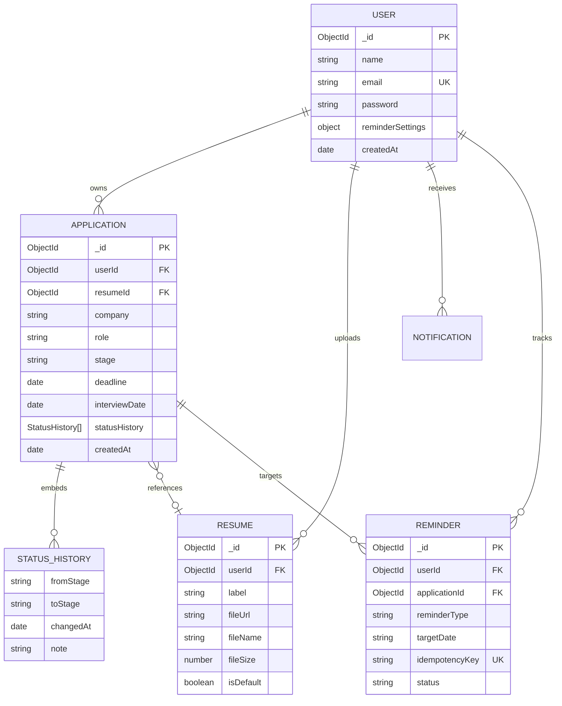

# ApplyTrack 🎯
### Intelligent Job & Internship Application Tracker with Smart Reminders & Pipeline Analytics

[](https://react.dev)
[](https://nodejs.org)
[](https://expressjs.com)
[](https://www.mongodb.com/atlas)
[](https://tailwindcss.com)
[](LICENSE)

ApplyTrack is a full-stack, university end-term capstone application built to solve the application management crisis faced by college students and fresh graduates. It replaces brittle spreadsheets with a real-time, drag-and-drop Kanban pipeline, a server-enforced finite state machine, automated background reminder sweeps, multi-version resume tracking, and native MongoDB aggregation analytics.

---

## 1. Problem Statement & Target Audience

### The Problem
College students apply to 50–200+ internships and new-grad roles across multiple platforms (LinkedIn, Handshake, company career portals, referrals). Without dedicated tooling:
1. **Missed Deadlines**: Deadlines slip by unsubmitted because dates are scattered across browser bookmarks.
2. **Ghosting & Stalled Applications**: Students forget when they applied and lose track of when to follow up.
3. **Resume Confusion**: Candidates tailor multiple resumes (e.g., SDE vs. Frontend vs. Data) but cannot identify which version yields interview callbacks.
4. **Spreadsheet Inadequacy**: Spreadsheets cannot automate daily reminder notifications, validate lifecycle state transitions, or compute time-to-response funnel metrics.

### Target Audience
* College students seeking summer internships and co-ops.
* Final-year undergraduates running concurrent on-campus and off-campus recruitment pipelines.
* Career coaches and university placement cells monitoring candidate progress.

---

## 2. Key Features & The 5 Core Workflows

### 🛡️ 1. Authentication & Tenant Ownership
* Secure registration and login with **bcrypt password hashing** (work factor 12).
* JWT authentication issued exclusively via **`httpOnly` cookies** with `SameSite` flags, protecting against client-side script token theft (XSS).
* Strict route guards ensuring all queries (`find`, `update`, `delete`, `aggregate`) are strictly scoped to `req.user.id`.
* Brute-force mitigation using `express-rate-limit` on authentication endpoints.

### 📋 2. Drag-and-Drop Kanban Pipeline with Server-Enforced State Machine
* Interactive Kanban board built with `@dnd-kit` featuring **optimistic UI updates** and **automatic rollback** on server rejection.
* Seven distinct lifecycle stages: `Wishlist` ➔ `Applied` ➔ `Online Assessment` ➔ `Interview` ➔ `Offer` ➔ `Rejected` (and `Withdrawn`).
* **Finite State Machine**: The server strictly rejects nonsensical stage jumps (e.g., jumping from `Wishlist` directly to `Offer` returns `422 Unprocessable Entity` with allowed next stages).
* **Audit Trail**: Every stage transition records an embedded `StatusHistory` entry containing the origin stage, target stage, timestamp, and optional reflection notes.
* **Duplicate Prevention**: Compound database index (`userId + company + role`, case-insensitive) prevents duplicate applications.

### 📄 3. Multi-Version Resume Management & Association
* Upload multiple customized PDF resumes with descriptive version tags (e.g., *"SDE Backend v2"*, *"Fullstack React Specialization"*).
* Single-click toggle to designate a global default resume for new applications.
* Strict validation: Multer enforces a 5MB size ceiling and PDF MIME-type verification.
* Dual-mode file storage: Streams to **Cloudinary** when cloud credentials exist, with an automatic fallback to local disk storage.
* **Referential Protection**: Resumes linked to active applications cannot be deleted until unlinked or reassigned.

### ⏰ 4. Smart Background Reminders & Idempotency Engine
* Automated daily `node-cron` worker scanning all active applications for 3 triggers:
  1. **48-Hour Deadline Alert**: Upcoming application deadlines within 48 hours.
  2. **Interview Tomorrow**: Interviews scheduled within the next 24–36 hours.
  3. **7-Day Stalled Application Follow-Up**: Applications remaining in *"Applied"* for 7+ days without status updates.
* **Idempotency Guarantee**: Dispatches are guarded by a unique compound key:
  $$\text{idempotencyKey} = \text{userId} + \text{applicationId} + \text{reminderType} + \text{YYYY-MM-DD}$$
  If the cron task restarts or runs twice in a day, duplicate key error `11000` is caught and duplicate emails or alerts are prevented.
* Sends dual dispatches: transactional HTML email via **Nodemailer** and in-app bell notifications. Respects per-user email notification preferences.

### 📊 5. Pipeline Analytics (MongoDB Aggregation Pipelines)
* **Stage Funnel**: Visualizes stage drop-off and conversion bottlenecks using Recharts.
* **Recruiter Response Rate**: Percentage of submitted applications that received a definitive response.
* **Offer Conversion Rate**: Percentage of applications converted to offers.
* **Average Days to First Response**: Aggregates the exact duration from the `Applied` timestamp to the first response stage change.
* **Application Velocity**: Tracks weekly application submissions over time.
* **Resume Version Comparison**: Compares interview callback rates across different resume PDF variants.
* **Graceful Zero-State**: Renders empty states for new accounts without crashing or displaying `NaN`.

---

## 3. System Architecture & Entity Relationships



### Entity-Relationship Model



---

## 4. RESTful API Specification (`/api/v1`)

| Method | Endpoint | Auth | Purpose | Success Status |
| :--- | :--- | :--- | :--- | :--- |
| **POST** | `/api/v1/auth/register` | Public | Register new account (Zod validated) | 201 Created |
| **POST** | `/api/v1/auth/login` | Public | Authenticate user & issue httpOnly cookie | 200 OK |
| **POST** | `/api/v1/auth/logout` | Private | Clear authentication cookie | 200 OK |
| **GET** | `/api/v1/auth/me` | Private | Fetch authenticated user profile | 200 OK |
| **PATCH**| `/api/v1/auth/settings` | Private | Update reminder preferences | 200 OK |
| **GET** | `/api/v1/applications` | Private | List applications (search, filter, sort) | 200 OK |
| **POST** | `/api/v1/applications` | Private | Create application (duplicate check) | 201 Created |
| **GET** | `/api/v1/applications/:id`| Private| Get application details & timeline | 200 OK |
| **PATCH**| `/api/v1/applications/:id`| Private| Update metadata (company, role, notes) | 200 OK |
| **PATCH**| `/api/v1/applications/:id/stage`| Private | Move stage (finite state machine verified) | 200 OK |
| **DELETE**| `/api/v1/applications/:id`| Private| Delete application & associated reminders | 200 OK |
| **GET** | `/api/v1/resumes` | Private | List user resumes with application counts | 200 OK |
| **POST** | `/api/v1/resumes` | Private | Upload PDF resume (Multer + Cloudinary) | 201 Created |
| **PATCH**| `/api/v1/resumes/:id/default`| Private| Set default resume version | 200 OK |
| **DELETE**| `/api/v1/resumes/:id` | Private | Delete resume (blocked if attached) | 200 OK |
| **GET** | `/api/v1/notifications`| Private | Get notifications and unread badge count | 200 OK |
| **PATCH**| `/api/v1/notifications/:id/read`| Private | Mark individual notification as read | 200 OK |
| **PATCH**| `/api/v1/notifications/read-all`| Private| Mark all notifications as read | 200 OK |
| **GET** | `/api/v1/analytics/overview`| Private | Aggregation analytics (funnel, response time)| 200 OK |
| **GET** | `/api/v1/health` | Public | System uptime & MongoDB connection probe | 200 OK |

---

## 5. Local Setup & Installation

### Prerequisites
* **Node.js**: v18.0.0 or higher
* **npm**: v9.0.0 or higher
* **MongoDB**: Local MongoDB instance or free [MongoDB Atlas](https://www.mongodb.com/atlas) cluster

### Quickstart Guide

1. **Clone the repository**:
   ```bash
   git clone https://github.com/adiityaa09/mern-end-term-project.git
   cd mern-end-term-project
   ```

2. **Configure Environment Variables**:
   * **Server Configuration**:
     ```bash
     cp server/.env.example server/.env
     ```
     Edit `server/.env` and supply your database connection string and secrets:
     ```env
     PORT=5000
     NODE_ENV=development
     CLIENT_URL=http://localhost:5173
     MONGODB_URI=mongodb://127.0.0.1:27017/applytrack
     JWT_SECRET=super_secure_development_jwt_secret_key_at_least_32_chars!
     JWT_EXPIRES_IN=7d
     ```
   * **Client Configuration**:
     ```bash
     cp client/.env.example client/.env
     ```

3. **Install Dependencies**:
   ```bash
   # From root directory:
   npm install --prefix server
   npm install --prefix client
   ```

4. **Run Automated Test Suites**:
   ```bash
   cd server
   npm test
   ```

5. **Start Development Servers**:
   * Run server:
     ```bash
     cd server
     npm run dev
     ```
   * In a second terminal, run client:
     ```bash
     cd client
     npm run dev
     ```
   * Open your browser at **`http://localhost:5173`**.

---

## 6. Environment Variables Reference

| Variable | Scope | Description | Default / Example |
| :--- | :--- | :--- | :--- |
| `PORT` | Server | HTTP port Express server listens on | `5000` |
| `NODE_ENV` | Server | Application runtime mode (`development` / `production`) | `development` |
| `CLIENT_URL` | Server | Permitted CORS frontend origin | `http://localhost:5173` |
| `MONGODB_URI` | Server | MongoDB Atlas or local connection URI | `mongodb+srv://...` |
| `JWT_SECRET` | Server | Secret cryptographic signing key for JWTs | 32+ character random string |
| `JWT_EXPIRES_IN`| Server | Validity window of JWT cookies | `7d` |
| `CLOUDINARY_CLOUD_NAME` | Server | Cloudinary Cloud name (optional; falls back to disk) | `your_cloud_name` |
| `CLOUDINARY_API_KEY` | Server | Cloudinary API Key | `your_api_key` |
| `CLOUDINARY_API_SECRET` | Server | Cloudinary API Secret | `your_api_secret` |
| `EMAIL_SERVICE` | Server | SMTP provider for Nodemailer | `gmail` |
| `EMAIL_USER` | Server | Email account address for dispatching alerts | `you@gmail.com` |
| `EMAIL_PASS` | Server | Gmail 16-character App Password | `xxxx xxxx xxxx xxxx` |
| `VITE_API_URL` | Client | Base URL for Axios requests | `http://localhost:5000/api/v1` |

---

## 7. Production Deployment Guide & Pitfalls

### Backend (Render / Railway)
1. Set the Root Directory to `server`.
2. Set Build Command to `npm install`.
3. Set Start Command to `npm start`.
4. Configure all environment variables in the host dashboard.
5. **Atlas IP Allowlist**: In MongoDB Atlas, go to *Network Access* and whitelist `0.0.0.0/0` (Allow Access from Anywhere) so Render/Railway cloud dynos can connect.

### Frontend (Vercel)
1. Set the Root Directory to `client`.
2. Framework Preset: **Vite**.
3. Build Command: `npm run build`.
4. Output Directory: `dist`.
5. Environment Variable: Set `VITE_API_URL` to your production backend URL (e.g., `https://applytrack-api.onrender.com/api/v1`).

### Deployment Pitfalls & Solutions
* **Cross-Site Cookies over HTTPS**:
  When frontend and backend are hosted on different domains (e.g., `vercel.app` and `onrender.com`), browsers reject third-party cookies unless:
  1. `secure: true` (HTTPS only).
  2. `sameSite: 'none'` (Permits cross-site transmission).
  3. `credentials: true` enabled on both Axios and Express CORS.
  *This is already handled out of the box in ApplyTrack's `auth.controller.js` and `app.js`.*
* **Free-Tier Cron Sleeping**:
  Free-tier hosts like Render sleep after 15 minutes of inactivity, which pauses standard in-process `node-cron` timers.
  *Solution*: Use a free cron ping service like [cron-job.org](https://cron-job.org) or UptimeRobot to ping `/api/v1/health` every 10 minutes to keep the container awake.

---

## 8. Viva-Voce Questions & Design Defense

#### Q1: Why store the JWT in an `httpOnly` cookie instead of `localStorage`?
**Answer**: Tokens saved in `localStorage` can be read by any JavaScript running in the browser. If an application has an XSS vulnerability, an attacker can steal the token (`document.cookie` cannot be read by JS when `httpOnly: true`). Combining `httpOnly` with `SameSite=Lax/Strict` and `secure: true` mitigates token exfiltration attacks.

#### Q2: How does the Smart Reminder engine achieve idempotency?
**Answer**: Idempotency is enforced through a unique compound index in MongoDB on the `Reminder` collection:
$$\text{idempotencyKey} = \text{userId} + \text{applicationId} + \text{reminderType} + \text{targetDate}$$
Before dispatching an email or creating a notification, the processor attempts to insert a reminder document with this key. If the cron job fires multiple times or restarts mid-batch, MongoDB throws a duplicate key error (code `11000`), allowing the engine to skip dispatching duplicate alerts.

#### Q3: Why validate stage transitions with a Finite State Machine on the server rather than just in the UI?
**Answer**: UI validation provides immediate feedback, but cannot be trusted for data integrity. A user or script could easily send a `PATCH` request directly to `/api/v1/applications/:id` jumping straight from `Wishlist` to `Offer`. The server-side state machine guarantees that every application strictly follows business domain rules, logging an accurate audit trail in `statusHistory`.

---

## 9. Limitations & Future Roadmap
* **OAuth Integration**: Google / GitHub single sign-on (SSO).
* **Calendar Sync**: Direct two-way synchronization of interview dates with Google Calendar / Outlook using the Google Calendar API.
* **AI Resume Matching**: Semantic similarity analysis comparing resume PDF text against job description keywords using embeddings.

---

## 10. Credits & Third-Party Libraries
* **Framework**: React 18, Vite, Express.js.
* **Database & ODM**: MongoDB Atlas, Mongoose.
* **Drag and Drop**: `@dnd-kit/core`, `@dnd-kit/utilities`.
* **Visualizations**: `recharts`.
* **Icons**: `lucide-react`.
* **Validation & Security**: `zod`, `bcryptjs`, `jsonwebtoken`, `helmet`, `express-rate-limit`.
* **File & Email Utilities**: `multer`, `cloudinary`, `node-cron`, `nodemailer`.
